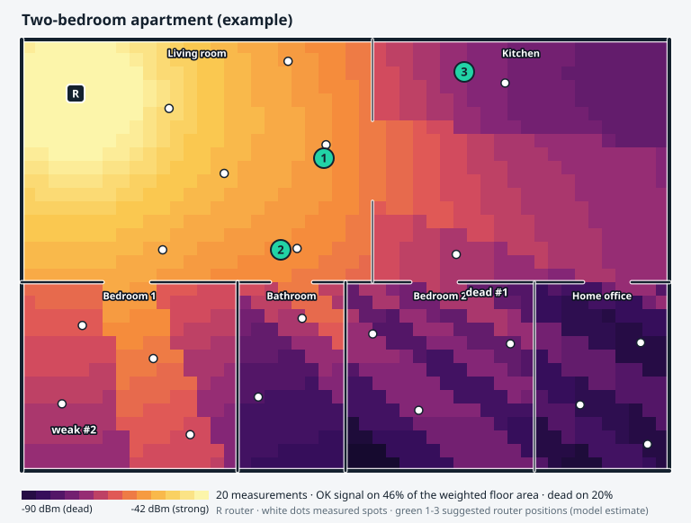

# SignalWalk

**Walk around with your laptop, click where you are standing, and get a Wi-Fi coverage map, a list of dead zones, and advice on where to put the router.**



<sub>Generated by `python -m signalwalk demo` from a **simulated** survey of the example apartment. Bright = strong signal, dark = dead zone. White dots are measured spots, **R** is the router, green **1-3** are suggested router positions.</sub>

> **Status: experimental prototype.** Everything here has been run on **simulated data only**. The code that reads a real Wi-Fi adapter is tested against sample tool output, **not on real hardware**. See [Limitations](#limitations).

---

## Overview

**What it is.** A small Python tool plus a web dashboard. You give it a floor plan (a short JSON file of walls and rooms), stand in different spots with a laptop, and it records the Wi-Fi signal strength at each spot. It then fits a physical model of how the signal fades with distance and walls, corrects it with what you actually measured, and draws a heatmap.

**What it tells you.**
- where the weak and dead zones are, how big they are, and which rooms they cover;
- a report card per room;
- where moving the router, or adding an extender, would help most, with an honest error bar;
- **where to measure next**, because the map also knows where it is guessing.

**Why it exists.** Router advice is usually "put it in the middle". Real homes have walls, doors, bathrooms and furniture, and nobody can see signal. This project was built as a portfolio piece that turns a household annoyance into a small modelling problem, runnable with no special hardware.

## Key features

- **Click-to-measure survey** on a live floor plan. Real mode reads your laptop's own signal strength; simulation mode uses a virtual house.
- **Physics plus data.** A multi-wall path-loss model (regularised regression with sensible priors) captures walls and distance; a Gaussian process corrects what the model misses and gives a confidence value everywhere.
- **Dead-zone finder** with area, severity, rooms affected and a per-room grade.
- **Placement advice** for moving the router or adding an extender (the extender must be able to hear the router).
- **Active surveying:** suggests the most informative spots to measure next.
- **Honest error reporting:** leave-one-out cross-validation shows the typical map error and compares it with plain interpolation.
- **Outputs:** interactive dashboard, terminal report with an ASCII map, standalone SVG heatmap, CSV/JSON survey files.
- **Privacy-minded:** stores only signal strength; never SSIDs or MAC addresses.

## Why this project is different

| Typical "Wi-Fi heatmap" approach | SignalWalk |
|---|---|
| Colour the dots, blur between them | Fits a wall-aware model, then corrects it with a Gaussian process, so unmeasured rooms behind walls are handled sensibly |
| No idea how wrong the map is | Reports a measured cross-validation error and draws a confidence layer |
| "Put the router in the middle" | Scores real candidate positions by *expected* coverage and compares with that rule of thumb |
| You decide where to measure | Tells you where one more measurement would reduce doubt the most |

**Established vs. my design.** Multi-wall path-loss models, Gaussian-process regression and leave-one-out cross-validation are well-known techniques, and Wi-Fi survey tools already exist. The *proposed design* here is the combination: a MAP-regularised multi-wall model + Matern GP residual map + model-only placement search with CV-derived error bars + uncertainty-driven "measure next" + a simulator whose ground truth deliberately differs from the estimator. The priors, thresholds and scoring rules are my own hand-chosen design values, not tuned on real buildings. I do not claim this combination is unique. See [docs/DESIGN_DECISIONS.md](docs/DESIGN_DECISIONS.md).

## System architecture

```
   Floor plan (JSON)      Laptop Wi-Fi adapter            Virtual house (simulator)
          │                 netsh / nmcli / macOS                    │
          │                        │                                 │
          └──────────┬─────────────┴──────────────┬──────────────────┘
                     ▼                            ▼
              Survey (validated points)   median of N readings per spot
                     │
                     ▼
   ┌───────────────────────────────────────────────────────────┐
   │ Analysis                                                  │
   │  1. fit multi-wall path-loss model (MAP regression)       │
   │  2. Gaussian process on residuals -> mean + std per cell  │
   │  3. dead zones · room report · leave-one-out error        │
   │  4. placement search (model only) · "measure next"        │
   └─────────────────────────────┬─────────────────────────────┘
                                 ▼
          FastAPI  /api/*  ──►  Browser dashboard (canvas heatmap)
                                 ├─► SVG / CSV / JSON exports
                                 └─► Terminal report (ASCII map)
```

Mermaid diagrams and the data flow: [docs/SYSTEM_ARCHITECTURE.md](docs/SYSTEM_ARCHITECTURE.md).

## How it works

1. **Describe the home.** `examples/floorplans/*.json` list walls (kind: light / interior / heavy), rooms, the router position and optional outlet positions.
2. **Measure.** At each spot the app takes 5 readings and keeps the **median**. Positions are metres from the top-left corner of the plan.
3. **Fit the model.** `RSSI = A - 10 n log10(d) - sum(wall loss x walls crossed)`. It is linear in its parameters, so it is a regularised linear regression with priors (a MAP estimate), bounded to physical ranges. Wall types never crossed by any measurement keep their prior.
4. **Correct it.** What the model gets wrong (furniture, doors, reflections) is smoothed with a Matern-3/2 Gaussian process. The result is a mean and a standard deviation for every 25 cm cell.
5. **Find problems.** Cells below -70 dBm are grouped into zones; below -80 dBm they are "dead". Rooms are graded.
6. **Advise.** Every allowed router position is scored by *expected coverage*: the weighted share of floor with P(signal >= -70 dBm), using the model alone and a CV-derived error. An extender is scored the same way but must hear the router at -65 dBm or better.
7. **Say where it is unsure.** The next measurement suggestions are the spots where weak-vs-OK is most uncertain.

Sample terminal output (simulated, trimmed):

```
 Leave-one-out error: hybrid 3.17 dB | model only 3.43 dB | plain interpolation 7.35 dB
 Room report card:
  Living room      median  -54.4 dBm   OK 100%   grade: good  (6 pts)
  Bedroom 2        median  -78.4 dBm   OK   0%   grade: dead  (3 pts)
  Home office      median  -86.0 dBm   OK   0%   grade: dead  (3 pts)
 Router placement (model estimate, error about 3.4 dB):
  now: about 50.6% of the weighted floor area has OK signal
  1. move to (5.6, 2.2) in Living room: about 72.0% (+21.4 points)
```

## Technology stack

| Technology | Purpose here |
|---|---|
| Python 3.10+ and NumPy | Everything numerical: regression, Gaussian process, geometry (no SciPy or ML framework) |
| FastAPI + Uvicorn | Local JSON API and static hosting |
| Pydantic | Request validation |
| PyYAML | Thresholds and model settings |
| Canvas + vanilla JavaScript | Click-to-measure floor plan and smooth heatmap, no build step, no external requests |
| SVG | Standalone shareable heatmaps (also the README image) |
| OS tools (`netsh`, `nmcli`, `/proc/net/wireless`, `system_profiler`) | Real signal readings, **not tested on hardware** |
| pytest, httpx | Tests |

## Project structure

```
signalwalk/
├── README.md  LICENSE  SECURITY.md  CONTRIBUTING.md  .gitignore  .env.example
├── pyproject.toml  requirements.txt  requirements-dev.txt
├── src/signalwalk/
│   ├── floorplan.py     walls, rooms, line-wall crossings
│   ├── survey.py        validated measurements, JSON/CSV
│   ├── collectors.py    OS signal readers and parsers
│   ├── propagation.py   multi-wall path-loss model (MAP fit)
│   ├── estimator.py     Gaussian process, cross-validation, IDW baseline
│   ├── deadzones.py     zones, room report
│   ├── placement.py     router / extender advice, "measure next"
│   ├── analysis.py      puts it together into one JSON result
│   ├── simulator.py     virtual house (SIMULATION ONLY)
│   ├── service.py  api.py  cli.py  render.py  evaluation.py  config.py
├── app/                 dashboard (index.html, static/app.js, style.css)
├── config/default.yaml  thresholds and model settings
├── examples/            floorplans/, surveys/ (simulated), README
├── docs/                architecture, decisions, evaluation, install, ...
├── scripts/             dev-only dashboard smoke test (jsdom)
└── tests/               82 pytest tests
```

The simulator lives inside the package (`src/signalwalk/simulator.py`) so the CLI, API and tests can import it.

## Installation

Python 3.10 or newer.

```bash
git clone https://github.com/<your-username>/signalwalk.git
cd signalwalk
python -m venv .venv
source .venv/bin/activate          # Windows PowerShell: .venv\Scripts\Activate.ps1
pip install -e ".[dev]"
```

More detail: [docs/INSTALLATION.md](docs/INSTALLATION.md).

## Configuration

`config/default.yaml` holds everything tunable: thresholds (`strong -55`, `weak -70`, `dead -80` dBm), grid size, model priors, Gaussian-process settings, placement rules. **There are no secrets or API keys.** Optional environment variables (see `.env.example`): `SIGNALWALK_HOST`, `SIGNALWALK_PORT`, `SIGNALWALK_MODE`, `SIGNALWALK_SIM_SEED`, `SIGNALWALK_CONFIG`, `SIGNALWALK_APP_DIR`.

To use your own home, copy `examples/floorplans/apartment.json`, edit the walls/rooms/router position, then run `python -m signalwalk validate-floorplan my_home.json`.

## Running the project

```bash
python -m signalwalk demo                         # terminal report from a simulated survey (~1 s)
python -m signalwalk serve --simulate             # virtual house in the browser: http://127.0.0.1:8000
python -m signalwalk serve --real --floorplan my_home.json     # measure your real Wi-Fi
python -m signalwalk check-reader                 # can this computer's Wi-Fi be read?
python -m signalwalk survey --floorplan my_home.json           # terminal-only real survey
python -m signalwalk analyze examples/surveys/apartment_demo.csv --floorplan apartment --svg out.svg
python -m signalwalk --help
```

## Demo / simulation mode

No hardware needed.

1. `python -m signalwalk serve --simulate` and open <http://127.0.0.1:8000>.
2. Click **Auto-survey 10 spots** (or click anywhere on the plan to "measure" there).
3. Watch the heatmap, the coverage bar, the zones and the room report card appear.
4. Tick **Show confidence**: pale areas are where the map is guessing. Dashed **?** rings say where to measure next.
5. Look at the green **1-3** markers (router moves) and the blue **E** (extender), then hover anywhere for a predicted dBm with its error bar.
6. Export the heatmap as SVG or the survey as CSV.

## Testing

```bash
python -m pytest                       # 82 tests, about 8 s
python -m signalwalk evaluate          # synthetic evaluation, about 25 s
```

Measured on **simulated** data (30 random virtual homes per plan, seed 1000; the simulator uses a *different* propagation model from the estimator, but both were written by me):

| Plan | Survey points | Hybrid map error | Plain interpolation error | Router advice, true coverage: before → after (best possible) |
|---|---:|---:|---:|---|
| Apartment | 20 | 2.6 dB | 5.3 dB | 70.5% → 90.3% (91.1%) |
| Office | 20 | 3.0 dB | 7.0 dB | 52.6% → 71.7% (80.1%) |

Following the advice made the true coverage more than 1 point worse in 0% (apartment) and 3% (office, 20 points) of simulated homes. A "put it in the centre" rule with no survey reached 85.8% (apartment) and 50.2% (office). Full tables, method and caveats: [docs/EVALUATION.md](docs/EVALUATION.md). Test strategy: [docs/TEST_PLAN.md](docs/TEST_PLAN.md).

## Limitations

- **Simulation only.** Nothing was measured in a real building. The real-Wi-Fi readers are tested against sample output written from the tools' documented formats; they have **not been run on real hardware**. The macOS reader in particular may not work on newer macOS versions.
- **Evaluation is partly circular.** The simulator is my own model. The ground truth differs from the estimator (two-slope loss, per-wall variation, hidden furniture, correlated shadowing), but real buildings may behave differently, and the thresholds and priors were chosen by me.
- **Signal strength, not speed.** RSSI is not throughput. Interference, channel congestion and the router's own settings are ignored.
- **Single access point, single floor, single band assumed.** Roaming between mesh nodes or band-steering between 2.4 and 5 GHz mixes data; the tool only warns when it sees the access-point tag change.
- **You must draw the plan.** Wall positions and your standing positions are entered by hand; errors in either degrade the fit.
- **Advice is an estimate.** It uses the fitted model only, assumes the new router radiates like the old one, and showed the wrong direction in a few simulated homes (see above).
- **Laptop readings are rough.** Operating systems smooth and quantise values, and antenna orientation matters; hold the laptop steady and keep it at the same height.
- **Dashboard not verified in a real browser.** It passes a headless jsdom smoke test (canvas stubbed); how it looks and behaves in real browsers, on phones or with assistive tech is untested.
- **No authentication.** Local single-user tool; see [SECURITY.md](SECURITY.md).
- **Timing.** One full analysis took roughly 0.03-0.2 s on the development sandbox for 20 points. That is a single observation, not a benchmark.

## Future improvements

Ideas, none implemented:

- Validate against real surveys, including a comparison with a commercial survey tool, and publish honest errors.
- Throughput and latency measurement (a local `iperf`-style test) instead of signal strength only.
- Import a floor plan from a photo or a simple drawing tool.
- Multi-AP / mesh support and multiple floors.
- Phone-based surveying (a small companion app) for places where carrying a laptop is awkward.
- Fit the Gaussian-process hyperparameters from data.

## Security

Local-only by default (`127.0.0.1`), warns if bound elsewhere, no secrets, fixed OS commands without a shell, input validation, strict CSP, privacy-minded storage. There is **no authentication**. Details and gaps: [SECURITY.md](SECURITY.md).

## License

MIT. See [LICENSE](LICENSE). Replace `<YOUR NAME>` in the license file before publishing.
