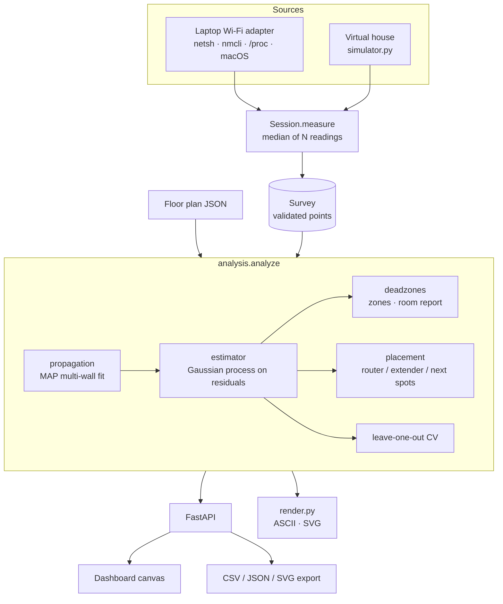
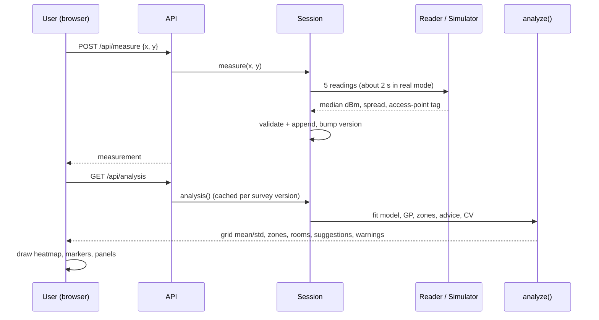

# System Architecture

Status: prototype, validated on simulated data only.

## Components



| Module | Responsibility |
|---|---|
| `floorplan.py` | Plan model, validation, vectorised wall-crossing counts, candidate positions |
| `survey.py` | `Measurement`, validated `Survey`, JSON/CSV I/O |
| `collectors.py` | OS signal readers and parsers, median-of-N spot measurement, roaming tag |
| `propagation.py` | `RSSI = A - 10 n log10 d - sum(wall losses)` as a bounded MAP regression |
| `estimator.py` | Matern-3/2 Gaussian process, `FittedMap.predict`, leave-one-out CV, IDW baseline |
| `deadzones.py` | Connected-component zones, severity, per-room grades, normal CDF |
| `placement.py` | Expected-coverage scoring, router moves, extender, "measure next" |
| `analysis.py` | Orchestrates everything into one JSON-ready dict plus warnings |
| `simulator.py` | Virtual world with a different propagation model (SIMULATION ONLY) |
| `service.py`, `api.py` | Session state and the HTTP surface |
| `render.py`, `cli.py`, `evaluation.py` | Reports, commands, synthetic evaluation |

Rule: `propagation`, `estimator`, `deadzones` and `placement` know nothing about HTTP, files or the simulator.

## Data flow



## The model in one place

For a point `p` and router `a`:

```
mean(p) = A - 10 n log10(max(|p - a|, 1 m)) - w_light c_light(p) - w_interior c_interior(p) - w_heavy c_heavy(p)
          + k(p, X) (K + s_n^2 I)^-1 r            # Gaussian-process correction of the residuals r
var(p)  = s_f^2 - k(p, X) (K + s_n^2 I)^-1 k(X, p)
```

`c_kind(p)` counts the walls of that kind crossed by the straight line from router to `p`. `(A, n, w)` come
from a bounded MAP regression, `k` is a Matern-3/2 kernel. Placement advice evaluates only the first line
with a moved router.

## API

| Method and path | Purpose |
|---|---|
| `GET /` | Dashboard |
| `GET /api/health`, `/api/state` | Status; floor plan, mode, measurements, thresholds |
| `GET /api/analysis` | Grid (mean, std), model, CV, coverage, zones, rooms, suggestions, warnings |
| `POST /api/measure` | `{x, y}` in metres; takes a measurement (422 outside plan, 503 if the adapter cannot be read, 409 if busy) |
| `DELETE /api/measurements/{i}`, `POST /api/reset` | Edit the survey |
| `POST /api/sim/auto-survey` | Simulation mode only |
| `GET /api/export/survey.csv`, `survey.json`, `heatmap.svg` | Downloads |

FastAPI serves interactive docs at `/docs` while the server runs.
