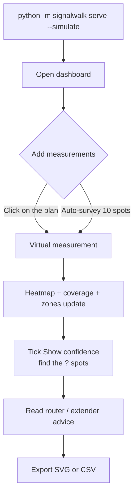
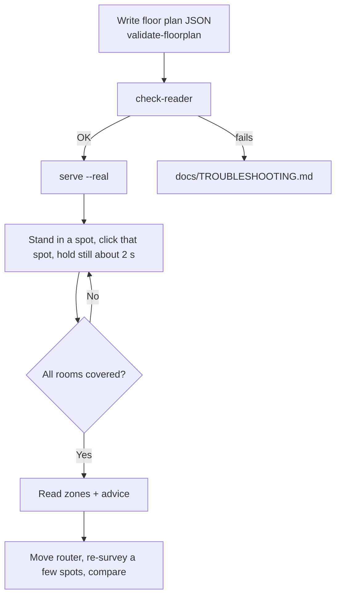

# User Flow and Survey Guide

## Demo flow (simulation)

## Real survey flow

## How to survey well

1. **Measure the home first.** Use a tape measure or a laser measure; get wall positions to about 10 cm. Write the plan with doorway gaps.
2. **Connect to the router you want to map** and stay on one network and one band if you can (force 5 GHz or 2.4 GHz in the adapter settings). If your device roams to another access point, the tool warns you.
3. **Walk the rooms.** At least one spot per room, more in big rooms and at room edges. Ten to twenty spots is a sensible start; the tool warns below 10.
4. **Stand still, same height each time** (for example the laptop on your lap while seated). Orientation of the laptop changes readings by several dB.
5. **Click your exact position** on the plan, then hold still for the 5 readings (about 2 seconds).
6. **Use "Measure next".** The dashed **?** rings are where one more measurement helps most.
7. **Delete odd points** (the list marks noisy ones), then compare before and after moving the router.

## What each result means

| Result | Meaning |
|---|---|
| Coverage bar | Share of the (room-weighted) floor with strong / OK / weak / dead signal |
| Zone `dead #1` | Connected area below -80 dBm; area, worst value and rooms are listed |
| Room grade | good, fair, poor or dead, from the share of the room at or above -70 dBm |
| Green 1-3 | Candidate router positions ranked by expected coverage (model estimate) |
| Blue E | Best extender position that still hears the router at -65 dBm or better |
| Dashed ? | Where the map cannot tell weak from OK |
| "Typical map error" | Leave-one-out error in dB, compared with plain interpolation |
